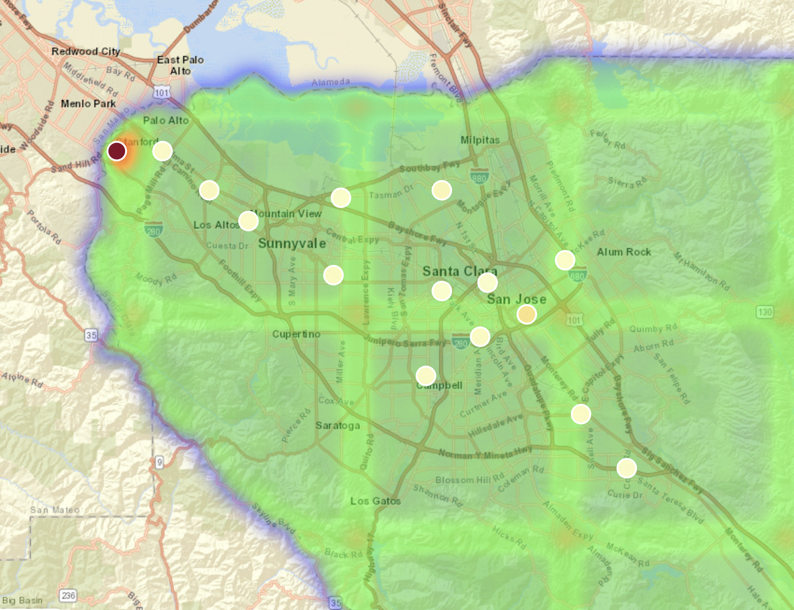

# Transit-PlanningML

A tool that predicts where new transit stations should go in any US metro area. It trains an XGBoost ridership model on census data for BART stations, then uses that model to choose station locations and routes for a new metro, shown on an interactive map.



## Results

- XGBoost ridership model with **7.5% MAE of mean ridership** on BART stations.
- Adding spatially-aware features (job-center proximity from LODES workplace data and population/employment density ratios) improved MAE from **10% to 7.5%** of mean ridership.

## How it works

1. **Data:** ACS 5-year census estimates and TIGER tract boundaries for demographics, and LODES data for where people work.
2. **Features:** demographic and employment features per census tract, including job-center proximity and population/employment density ratios.
3. **Model:** a gradient boosted decision tree (XGBoost) trained to predict station ridership from the surrounding area's characteristics.
4. **Planning:** a greedy spatial search uses the model's predictions to pick station locations, and routes are generated between them.
5. **Output:** an interactive HTML map (Folium) of the proposed stations and routes.

## Getting started

### Requirements

- Python 3.9+
- A free Census API key: https://api.census.gov/data/key_signup.html

Install dependencies:

```bash
pip install numpy pandas geopandas shapely folium xgboost matplotlib scikit-learn scipy requests
```

### Data sources

All data is downloaded automatically:

- ACS 5-year estimates (2023), via the Census API
- TIGER/Line tract boundaries, from the Census Bureau
- LODES workplace data (2021), from LEHD

### Run it on a metro area

1. Open `finished_prod/final_flow.ipynb`.
2. In the first cell, fill in:
   - Latitude/longitude bounds for the area
   - The counties to include
   - The state name and FIPS code
   - Any settings for the station network you want to create

   Example values are provided, so you can run it as-is to get an initial visualization.
3. Run all cells.
4. Open the HTML file the notebook creates to view the map.

## Why

Building transit infrastructure is expensive and slow, so any tool that speeds up planning helps. The map also shows where people, jobs, and wealth concentrate in different US metro areas.
